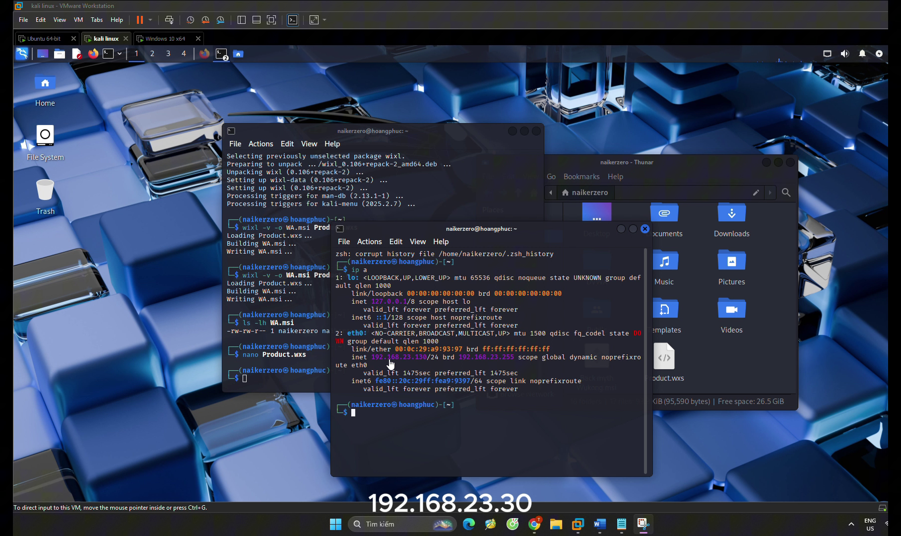
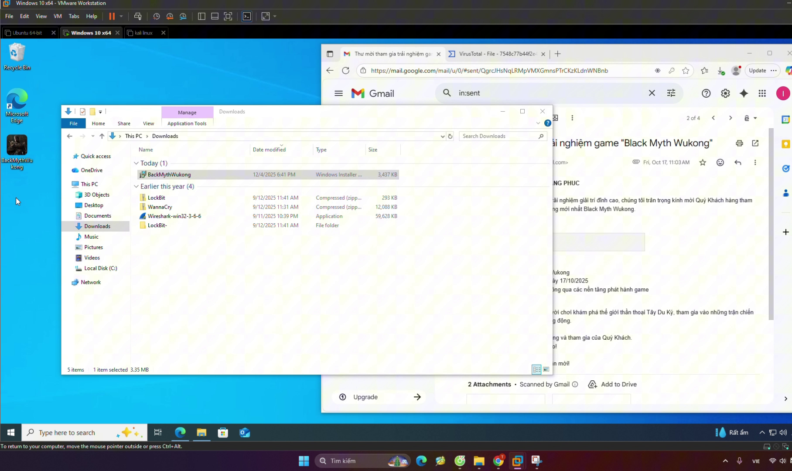
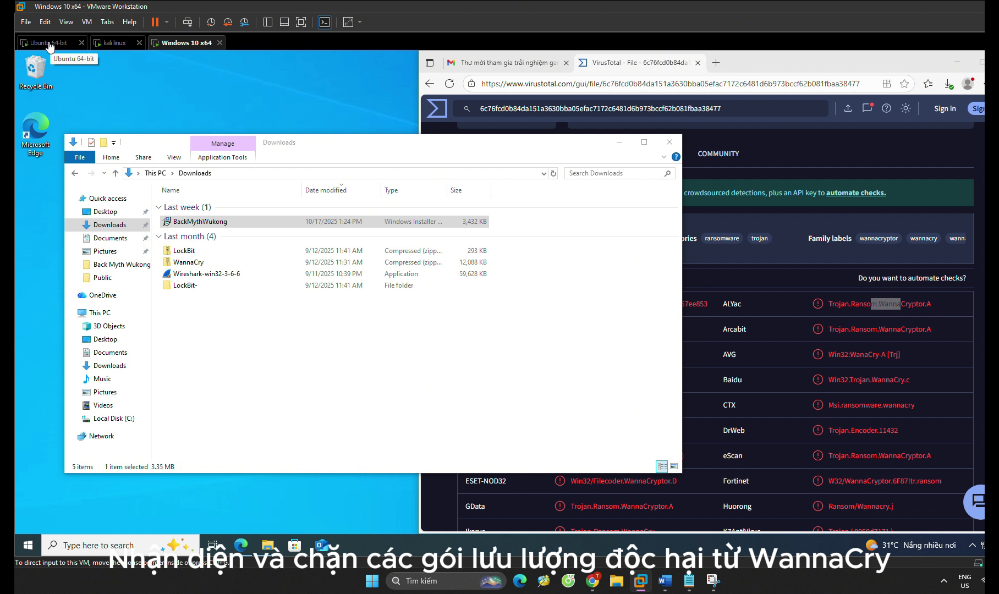
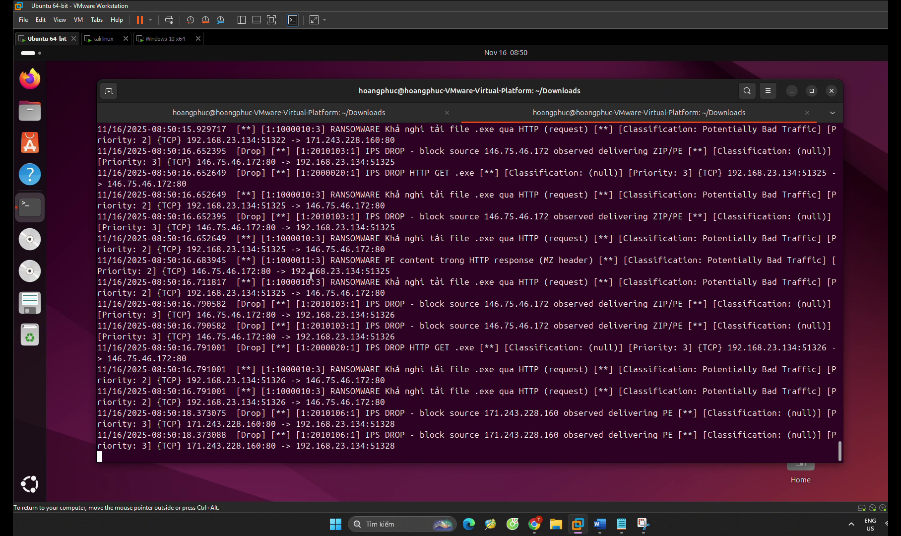
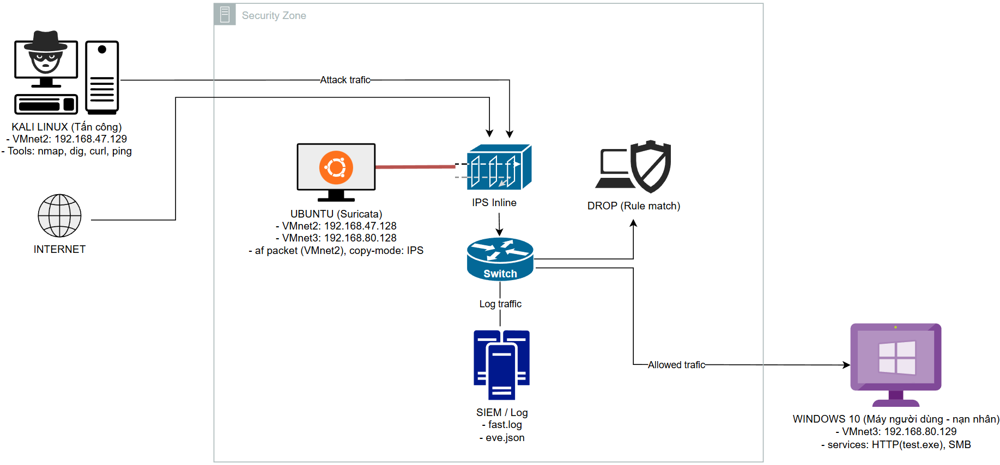
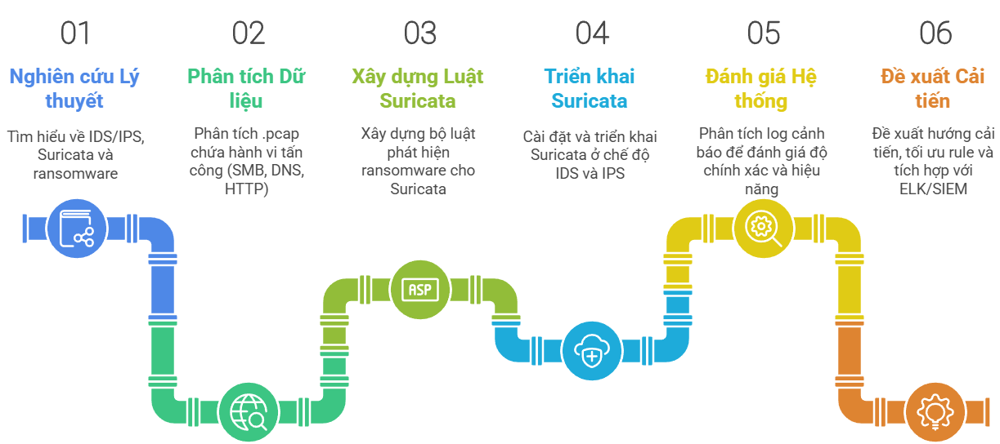
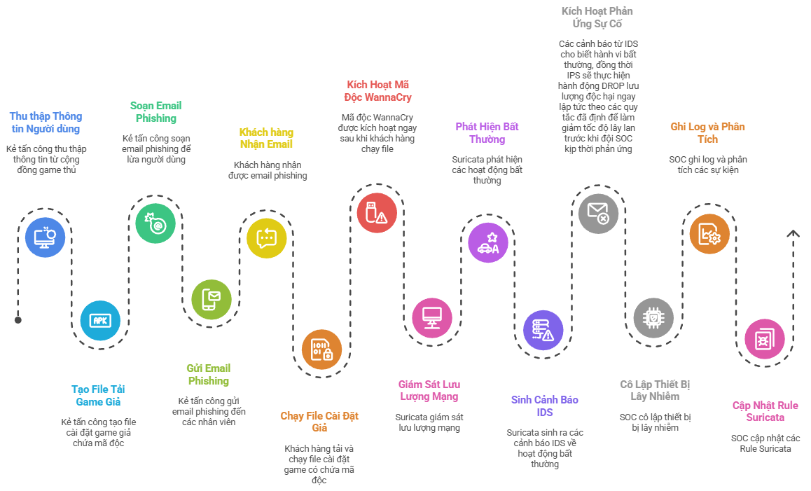
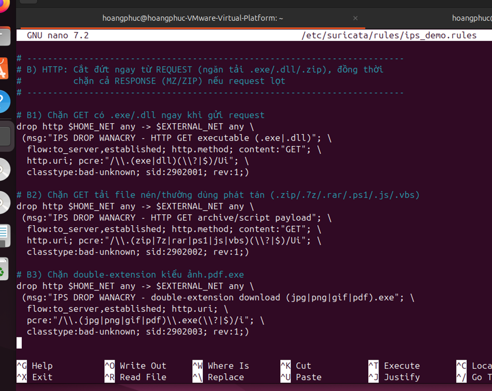
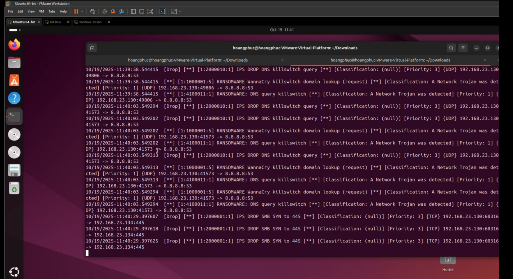
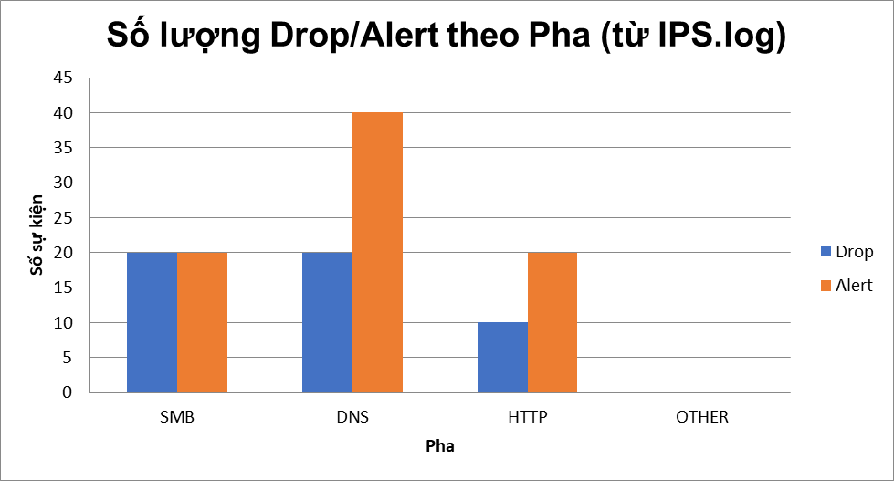

# 🛡️ Ransomware Detection & Prevention System (IDS/IPS with Suricata)

[](https://suricata.io/)
[](#)
[](https://www.vmware.com/)
[](#)
[](#)
[](LICENSE)

> 🎓 **Cybersecurity Capstone Project — Đồ án Chuyên ngành An Ninh Mạng (HUTECH | Sep 2025 – Nov 2025)**  
> **Đề tài:** *Xây dựng hệ thống IDS/IPS nhận diện mẫu lưu lượng Ransomware với Suricata*  
> **Team Lead & Primary Implementer (Trưởng nhóm & Triển khai chính):** **Tiêu Hoàng Phúc** (`2280602483` — Lớp `22DTHA1`)  
> **Team Member (Thành viên):** Nguyễn Phú Đạt (`2280619006` — Lớp `22DTHA1`) | **GVHD:** KS. Đinh Huỳnh Tuệ Tuệ  
>
> 🔗 **Quick Links (Tài liệu & Demo trực tiếp cho Nhà tuyển dụng / Giảng viên):**  
> 🎬 [**Watch Live Demo Video (MP4)**](https://drive.google.com/file/d/1-BlyFzWpnag3Q7lFPRkh6HN_DxRM-7c7/view?usp=drive_link) &nbsp;|&nbsp; 📁 [**Google Drive Project Folder**](https://drive.google.com/drive/folders/1ebBT8lkQBgiXf-wst0CD1hmta1t3FRg9) &nbsp;|&nbsp; 📘 [**Báo cáo Word (.DOCX)**](docs/TieuHoangPhuc2280602483_DOANCN.docx) ([*Google Docs*](https://docs.google.com/document/d/1g8FecWMRNVImO8z8poIi-4xcvOY7C_oS/edit?usp=drive_link)) &nbsp;|&nbsp; 📊 [**Slide Bảo vệ (.PPTX)**](docs/XAY_DUNG_HE_THONG_IDS_IPS_SURICATA.pptx) ([*Google Slides*](https://docs.google.com/presentation/d/1N2g-2fpuxjIXm4bU_qWm9IqLRdjnnYNB/edit?usp=drive_link))

An enterprise-simulated **Network Intrusion Detection and Prevention System (NIDS/NIPS)** deployed in **IPS Inline Mode (`AF-PACKET`)** using **Suricata** on an Ubuntu Linux Gateway to detect, alert, and actively drop **Ransomware** traffic (WannaCry, LockBit, SMB lateral movement, HTTP payload droppers, and DGA/C2 beacons) across segmented virtual networks.

Hệ thống mô phỏng kiến trúc **Phát hiện và Ngăn chặn Xâm nhập Mạng (IDS/IPS)** hoạt động ở chế độ **IPS Inline (`AF-PACKET`)** trên Ubuntu Gateway, giúp bóc tách gói tin từ tầng L2–L7, cảnh báo sớm và chủ động cắt đứt (`drop`) các luồng tấn công **Ransomware** theo thời gian thực trước khi mã độc kịp lây lan hoặc mã hóa dữ liệu.

### ✨ Key Technical Highlights (Tóm tắt Kỹ thuật Trọng tâm)

**English (CV Summary):**
* **3-VM Inline IPS Architecture:** Architected and deployed a 3-VM network security lab (`Kali Linux`, `Ubuntu Suricata Gateway`, `Windows 10`) in **IPS Inline mode** via `af-packet` across dual interfaces (`ens33`, `ens37`), configuring `host-os-policy` and protocol port groups.
* **Custom Detection & Prevention Rules:** Authored custom IDS/IPS rules (`content`, `pcre`, `threshold`) mapped to **MITRE ATT&CK** to alert and actively `drop` SMBv1 (`MS17-010`) exploits, HTTP `.exe`/`.msi`/double-extension payloads (`MZ` header), SMB write bursts, and DNS DGA/killswitch queries.
* **100% Detection & SOC Triage Correlation:** Validated rules against simulated phishing chains and `.pcap` traces, achieving **100% detection and inline drop** of core attack behaviors; correlated Suricata logs (`fast.log`, `eve.json`) with **Windows Event Logs (`4688`, `4663`, `7036`)** for SOC incident timeline reconstruction.

**Tiếng Việt (Tóm tắt Đồ án):**
* **Thiết kế & Triển khai Lab IPS Inline 3 Máy ảo:** Xây dựng mô hình mạng bảo mật gồm 3 máy ảo (`Kali Linux`, `Ubuntu Suricata Gateway`, `Windows 10`) hoạt động ở chế độ **IPS Inline** qua cơ chế cầu nối `af-packet` trên 2 card mạng (`ens33`, `ens37`), tối ưu hóa chính sách hệ điều hành (`host-os-policy`) và phân nhóm cổng giao thức.
* **Xây dựng Bộ luật IDS/IPS Tùy chỉnh:** Thiết kế bộ rule phát hiện và ngăn chặn chuyên sâu (`content`, `pcre`, `threshold`) ánh xạ theo khung **MITRE ATT&CK** nhằm cảnh báo và chủ động cắt đứt (`drop`) các khai thác lỗ hổng SMBv1 (`MS17-010`), hành vi tải payload `.exe`/`.msi`/đuôi kép (`*.pdf.exe`, nhận diện `MZ` header) qua HTTP, ghi/mã hóa file SMB hàng loạt (`Write AndX`) và truy vấn DNS DGA/Killswitch.
* **Kiểm thử Thực nghiệm & Truy vết Sự cố theo Quy trình SOC:** Kiểm chứng bộ luật trên kịch bản tấn công Phishing kết hợp tập mẫu `.pcap`, đạt tỷ lệ **100% phát hiện và chặn chủ động** các hành vi tấn công cốt lõi; phân tích tương quan log Suricata (`fast.log`, `eve.json`) với **Windows Event Logs (`4688`, `4663`, `7036`)** để tái dựng toàn bộ chuỗi thời gian (timeline) sự cố.

> [!NOTE]
> **Ghi chú Lưu trữ & Khôi phục Dự án (Project Recovery Note):**  
> Trong quá trình thực hiện đồ án, máy tính làm việc chính không may bị nhiễm mã độc nên môi trường máy ảo (VM) gốc không còn nguyên vẹn. Các tư liệu gốc còn lưu giữ được bao gồm: **mã nguồn mẫu thử mã độc (payload/malware source)**, **báo cáo thuyết minh Word (`.docx`)**, **video quay thực nghiệm (`.mp4`)** và **slide báo cáo (`.pptx` / `.pdf`)** *(không đăng tải mã nguồn mã độc trực tiếp lên GitHub vì lý do an toàn)*. Toàn bộ file cấu hình Suricata, bộ luật IDS/IPS, mẫu log và sơ đồ trong repository này đã được trích xuất và tái tạo chuẩn xác từ các tài liệu gốc đó.
>
> *During the project period, the primary host machine was affected by a malware incident. The surviving original materials include the **test payload source code**, the **Word technical report (`.docx`)**, the **demo video (`.mp4`)**, and the **presentation slides (`.pptx` / `.pdf`)** (malware source code is omitted from this public repo for safety compliance). All Suricata configurations, rules, logs, and diagrams in this repository were faithfully reconstructed from those surviving artifacts.*

---

## 📑 Table of Contents / Mục lục

1. [🎥 Live Demo & Attack-Defense Walkthrough](#-live-demo--attack-defense-walkthrough)
2. [📂 Repository Structure / Cấu trúc Thư mục](#-repository-structure--cấu-trúc-thư-mục)
3. [🏗️ Lab Infrastructure & Network Topology](#️-lab-infrastructure--network-topology)
4. [⚙️ Key Infrastructure & Security Configurations](#️-key-infrastructure--security-configurations)
5. [🎯 Custom Rules & MITRE ATT&CK Mapping](#-custom-rules--mitre-attck-mapping)
6. [🚀 Quick Deployment & Testing Guide](#-quick-deployment--testing-guide)
7. [🔍 SOC Incident Reconstruction & Experimental Results](#-soc-incident-reconstruction--experimental-results)
8. [📄 Project Documentation / Tài liệu Đồ án](#-project-documentation--tài-liệu-đồ-án)

---

## 🎥 Live Demo & Attack-Defense Walkthrough

> 🎬 **Watch Full Attack-Defense Demo Video (MP4):** [**Click here to watch on Google Drive**](https://drive.google.com/file/d/1-BlyFzWpnag3Q7lFPRkh6HN_DxRM-7c7/view?usp=drive_link)

### End-to-End Experimental Stages / Các giai đoạn Thực nghiệm Tấn công & Phòng thủ

| 1. Trojanized `.msi` Payload Build (Kali Linux) | 2. Phishing Delivery & Execution (Windows 10) |
| :---: | :---: |
|  |  |
| Đóng gói mã độc `WA.msi` / `BackMythWukong.msi` qua `wixl` & Shellter trên máy Attacker (`192.168.47.129` / `192.168.23.130`). | Nạn nhân tải và chạy bộ cài đặt giả mạo *Black Myth: Wukong* (`3,437 KB`) từ email/trang web Phishing. |

| 3. Malware Signature Verification (VirusTotal) | 4. Real-Time Suricata IPS Inline Drops (Ubuntu) |
| :---: | :---: |
|  |  |
| Kiểm chứng mã băm mẫu thử trên VirusTotal: `Trojan.Ransom.WannaCryptor.A` / `Msi.ransomware.wannacry`. | Cầu nối `af-packet` trên Suricata chủ động chặn (`[Drop]`) các gói tin HTTP tải `.exe`/PE và SMBv1 theo thời gian thực. |

---

## 📂 Repository Structure / Cấu trúc Thư mục

```text
suricata-ransomware-ids-ips/
├── configs/
│   └── suricata-inline.yaml          # Cấu hình Suricata 7.0.x chế độ AF-PACKET IPS Inline (ens33 <-> ens37)
├── rules/
│   ├── ips_demo.rules                # Bộ luật IPS Inline chủ động chặn (drop/pass) SMBv1, HTTP payload & Killswitch
│   └── ransomware.rules              # Bộ luật IDS/IPS phát hiện hành vi tải .msi/.exe, PE header, SMB Write Burst & DGA
├── scripts/
│   └── deploy_suricata_ips.sh        # Script tự động hóa triển khai, tối ưu NIC, kiểm tra cú pháp & khởi chạy Suricata
├── logs-sample/
│   ├── fast.log                      # Mẫu log cảnh báo nhanh ([Drop] & Alert) thu thập từ thực nghiệm
│   └── eve-sample.json               # Mẫu log chuẩn JSON (EVE) phục vụ truy vết SOC & tích hợp SIEM
├── diagrams/                         # Sơ đồ kiến trúc mạng, luồng xử lý gói tin và ảnh chụp thực nghiệm
├── docs/
│   ├── TieuHoangPhuc2280602483_DOANCN.docx          # Báo cáo thuyết minh đồ án chuyên ngành đầy đủ
│   └── XAY_DUNG_HE_THONG_IDS_IPS_SURICATA.pptx      # Slide báo cáo bảo vệ đồ án
├── LICENSE                           # Giấy phép mã nguồn mở MIT
└── README.md                         # Tài liệu tổng quan và hướng dẫn triển khai dự án
```

---

## 🏗️ Lab Infrastructure & Network Topology



Hệ thống Lab được ảo hóa trên **VMware Workstation** với các phân vùng mạng Host-Only cô lập (`VMnet2` và `VMnet3`), kết nối bắt buộc qua máy chủ **Ubuntu Linux Gateway** chạy Suricata ở chế độ **IPS Inline (`AF-PACKET` bridge)**:

| Component | OS / Role | Network Interface & IP | Function / Nhiệm vụ |
| :--- | :--- | :--- | :--- |
| **Attacker Node** | Kali Linux | `VMnet2`: `192.168.47.129/24`<br>*(Lab phụ: `192.168.23.130/24`)* | Dựng cổng Phishing giả mạo, tạo payload `.msi`/`.exe`, mô phỏng C2 & rà quét (`nmap`, `dig`, `curl`, SMB exploit). |
| **IPS Gateway** | Ubuntu Server (Suricata) | `ens33`: `192.168.47.128/24`<br>`ens37`: `192.168.80.128/24` | Cầu nối IPS Inline (`AF-PACKET` `copy-mode: ips`), phân tích gói tin L2–L7 và `drop` luồng độc hại theo thời gian thực. |
| **Victim Endpoint** | Windows 10 | `VMnet3`: `192.168.80.129/24`<br>*(Lab phụ: `192.168.23.134/24`)* | Máy trạm mục tiêu thực thi dropper trong `C:\TestSandbox\EncryptedSim\` và ghi nhận Windows Security Event Logs. |
| **SOC / Log Analysis** | Suricata EVE + Windows EVTX | Local Telemetry Pipeline | Tương quan dữ liệu giữa `fast.log`, `eve.json` và Windows Event Viewer (`4688`, `4663`, `7036`) để dựng lại timeline sự cố. |

### Suricata Packet Processing Pipeline & Attack-Defense Workflow

| Suricata 4-Stage Engine Architecture | 10-Step Attack & SOC Response Lifecycle |
| :---: | :---: |
|  |  |

---

## ⚙️ Key Infrastructure & Security Configurations

* **Inline Packet Inspection (`AF-PACKET`):** Cấu hình cặp card mạng `ens33` và `ens37` ở chế độ `copy-mode: ips` kết hợp cơ chế cân bằng tải luồng `cluster_flow` và `tpacket-v3` trong [`configs/suricata-inline.yaml`](configs/suricata-inline.yaml) để đạt hiệu năng xử lý zero-copy và chặn gói tin tức thời.
* **OS-Aware Stream Reassembly (`host-os-policy`):** Ánh xạ chính xác địa chỉ IP của từng máy trạm vào chính sách hệ điều hành tương ứng (`windows` cho máy nạn nhân, `linux` cho Gateway/Kali) nhằm chống kỹ thuật phân mảnh gói tin TCP qua mặt IDS/IPS và giảm thiểu cảnh báo giả (False Positives).
* **Deep Application-Layer Parsing (`app-layer`):** Kích hoạt bộ giải mã chuyên sâu cho các giao thức trọng yếu thường bị Ransomware lợi dụng: **SMB** (`139, 445`), **HTTP**, **DNS** (`53`), và **TLS** (`443`).

---

## 🎯 Custom Rules & MITRE ATT&CK Mapping



Bộ luật tùy chỉnh được chia làm 2 nhóm trong thư mục [`rules/`](rules/): nhóm **chặn chủ động (`ips_demo.rules`)** và nhóm **phát hiện chuyên sâu theo hành vi (`ransomware.rules`)**:

| Rule File | SID | Action | MITRE ATT&CK | Target Vector & Detection Logic |
| :--- | :--- | :---: | :--- | :--- |
| [`rules/ips_demo.rules`](rules/ips_demo.rules) | `2900000` | `pass` | `T1071.004` (DNS) | Cho phép truy vấn tên miền Killswitch của WannaCry (`iuqerfsodp9ifjaposdfjhgosurijfaewrwergwea.com`) để mã độc tự hủy. |
| [`rules/ips_demo.rules`](rules/ips_demo.rules) | `2901001`<br>`2901002` | `drop` | `T1046` (Network Scan)<br>`T1210` (Exploit Remote Services) | Chặn ngay từ gói `TCP SYN` (cổng `445`) chiều ra/vào nhằm ngăn rà quét và phát tán ngang qua SMB. |
| [`rules/ips_demo.rules`](rules/ips_demo.rules) | `2901003` | `drop` | `T1210` (MS17-010 / EternalBlue) | Nhận diện và chặn chữ ký giao thức **SMBv1** (`\|FF 53 4D 42\|` ở 4 byte đầu payload). |
| [`rules/ips_demo.rules`](rules/ips_demo.rules) | `2902001`<br>`2902002`<br>`2902003` | `drop` | `T1105` (Ingress Tool Transfer)<br>`T1036.007` (Double Extension) | Cắt đứt kết nối HTTP `GET` tải trực tiếp file thực thi (`.exe`, `.dll`), script/nén (`.zip`, `.7z`, `.ps1`, `.vbs`) hoặc giả mạo đuôi kép (`*.pdf.exe`, `*.jpg.exe`). |
| [`rules/ransomware.rules`](rules/ransomware.rules) | `100001`<br>`1000010`<br>`1000011` | `alert` | `T1204.002` (Malicious File)<br>`T1105` (Ingress Tool Transfer) | Cảnh báo khi phát hiện tải gói cài đặt `.msi`, request `.exe` hoặc phản hồi HTTP chứa **PE Header `MZ`** (`\|4D 5A\|`). |
| [`rules/ransomware.rules`](rules/ransomware.rules)<br>[`rules/ips_demo.rules`](rules/ips_demo.rules) | `200002`<br>`400004` | `alert`<br>`drop` | `T1486` (Data Encrypted for Impact)<br>`T1021.002` (SMB Shares) | Phát hiện và khóa hành vi ghi/mã hóa file hàng loạt qua mạng SMB (`Write AndX` vượt ngưỡng `10 lần / 5 giây`). |
| [`rules/ransomware.rules`](rules/ransomware.rules) | `300003`<br>`1000001` | `alert` | `T1568.002` (DGA)<br>`T1071.004` (DNS Beacon) | Phát hiện truy vấn DNS sinh tự động có độ dài/entropy cao (`pcre:"/^[a-z0-9]{20,}\./"`) và truy vấn tên miền WannaCry Killswitch. |

---

## 🚀 Quick Deployment & Testing Guide

### 1. Triển khai nhanh trên Ubuntu Gateway

Chạy script tự động để sao lưu cấu hình cũ, nạp bộ luật mới, tối ưu hóa card mạng (`promisc` & tắt `GRO/LRO/TSO/GSO`), kiểm tra cú pháp (`suricata -T`) và khởi chạy dịch vụ ở chế độ `AF-PACKET` daemon:

```bash
git clone https://github.com/Hoangphuc187/suricata-ransomware-ids-ips.git
cd suricata-ransomware-ids-ips

chmod +x scripts/deploy_suricata_ips.sh
./scripts/deploy_suricata_ips.sh ens33 ens37
```

*(Mặc định script sử dụng cặp interface `ens33` và `ens37`. Bạn có thể truyền tên card mạng thực tế của máy Ubuntu Gateway qua 2 tham số đầu vào).*

### 2. Kịch bản Kiểm thử Nhanh (Verification Commands)

Sau khi Suricata IPS Inline đã chạy trên Ubuntu Gateway, mở terminal theo dõi log thời gian thực:

```bash
sudo tail -f /var/log/suricata/fast.log
```

Thực hiện các lệnh mô phỏng hành vi tấn công từ máy **Victim / Attacker** đi xuyên qua Gateway để kiểm chứng khả năng `Alert` & `Drop`:

* **Test 1 — Kiểm tra DNS Killswitch & DGA Beacon (`SID 1000001`, `SID 300003`):**
  ```bash
  dig iuqerfsodp9ifjaposdfjhgosurijfaewrwergwea.com @8.8.8.8
  ```
* **Test 2 — Kiểm tra chặn tải mã độc `.exe` / Double-Extension qua HTTP (`SID 2902001`, `SID 2902003`):**
  ```bash
  curl -I http://192.168.47.129/payload/BlackMythWukong.exe --max-time 5
  curl -I http://192.168.47.129/invoice.pdf.exe --max-time 5
  ```
  *(Kết quả mong đợi: Kết nối bị treo và timeout do Suricata IPS chủ động `drop` gói tin HTTP GET, đồng thời sinh log `[Drop]` trong `fast.log`).*
* **Test 3 — Kiểm tra chặn rà quét và khai thác SMB cổng 445 (`SID 2901001`, `SID 2901002`):**
  ```bash
  nmap -p 445 192.168.80.129 -Pn
  ```
  *(Kết quả mong đợi: Cổng 445 hiển thị trạng thái `filtered` và Suricata ghi nhận `[Drop] IPS DROP WANACRY - inbound/outbound TCP/445 blocked (SYN)`).*

---

## 🔍 SOC Incident Reconstruction & Experimental Results

* **100% Detection & Inline Drop Rate** đối với các pha tấn công mô phỏng **WannaCry** (`MS17-010` SMBv1 + DNS Killswitch) và **LockBit / Trojan Dropper** (`HTTP .msi/.exe` + C2 Beacon + SMB Write Burst).
* Kết hợp dữ liệu cảnh báo mạng từ Suricata ([`logs-sample/fast.log`](logs-sample/fast.log), [`logs-sample/eve-sample.json`](logs-sample/eve-sample.json)) với nhật ký hệ thống **Windows Event Viewer** (`Event ID 4688` Process Creation, `4663` File System Access, `7036` Service Control Manager) để tái dựng toàn bộ chuỗi sự cố (Kill Chain) và cô lập máy trạm kịp thời.

| Real-Time Terminal Alert & Drop Verification | Drop vs. Alert Distribution by Attack Phase (`IPS.log`) |
| :---: | :---: |
|  |  |

### Mẫu Log Thực nghiệm (`logs-sample/fast.log`)

```text
10/19/2025-11:39:58.544415  [**] [1:1000001:5] RANSOMWARE WannaCry killswitch domain lookup (request) [**] [Classification: A Network Trojan was detected] [Priority: 1] {UDP} 192.168.23.130:49806 -> 8.8.8.8:53
10/19/2025-11:40:29.397607  [Drop] [**] [1:2000001:1] IPS DROP SMB SYN to 445 [**] [Classification: (null)] [Priority: 3] {TCP} 192.168.23.130:60316 -> 192.168.23.134:445
11/16/2025-08:50:15.929717  [**] [1:1000010:3] RANSOMWARE Kha nghi tai file .exe qua HTTP (request) [**] [Classification: Potentially Bad Traffic] [Priority: 2] {TCP} 192.168.23.134:51322 -> 171.243.228.160:80
11/16/2025-08:50:16.652649  [Drop] [**] [1:2000020:1] IPS DROP HTTP GET .exe [**] [Classification: (null)] [Priority: 3] {TCP} 192.168.23.134:51325 -> 146.75.46.172:80
11/15/2025-14:22:21.559204  [Drop] [**] [1:400004:1] DROP - Ransomware SMB Behavior Detected [**] [Classification: Misc activity] [Priority: 3] {TCP} 192.168.80.129:49820 -> 192.168.47.129:445
```

### Đánh giá Lỗ hổng & Khuyến nghị Phòng thủ (Risk Matrix & Remediation)

Dựa trên kết quả thực nghiệm từ báo cáo đồ án, bảng dưới đây tổng hợp các điểm yếu cốt lõi trong hạ tầng mạng và giải pháp khắc phục theo chiều sâu (Defense-in-Depth):

| Mã | Điểm yếu chính (Vulnerability) | Mức độ rủi ro | Giải pháp Phòng thủ Đề xuất (Remediation) |
| :---: | :--- | :---: | :--- |
| **V1** | Giao thức **SMBv1** chưa vá lỗi (`MS17-010` / EternalBlue) | 🔴 **Cao** | Cập nhật bản vá bảo mật, vô hiệu hóa hoàn toàn SMBv1 qua GPO, chặn cổng `TCP/445` giữa các phân đoạn VLAN. |
| **V2** | Lưu lượng **DNS Egress** không được kiểm soát | 🟠 **Trung bình** | Triển khai DNS Filtering / Sinkhole, chặn truy vấn DNS trực tiếp ra ngoài và bắt buộc đi qua DNS Server nội bộ. |
| **V3** | Cho phép tải trực tiếp file thực thi (`.exe`, `.msi`) qua HTTP | 🟠 **Trung bình** | Sử dụng Suricata IPS `drop` theo phần mở rộng & `MZ` magic byte, kết hợp Web Proxy lọc tệp và Whitelist domain. |
| **V4** | Cảnh báo DNS dư thừa & thiếu tương quan đa tầng | 🟡 **Thấp - TB** | Tinh chỉnh ngưỡng `threshold` trong rule Suricata, tích hợp log `eve.json` cùng Windows Event (`4688`, `4663`, `7036`) vào **SIEM (ELK / Wazuh)** và bổ sung **EDR**. |

---

## 📄 Project Documentation / Tài liệu Đồ án

Toàn bộ báo cáo thuyết minh chi tiết, slide thuyết trình và video demo của đồ án được lưu trữ trực tiếp trong thư mục [`docs/`](docs/) và trên Google Drive:

* 🎬 **Video Demo Thực nghiệm (Full Demo MP4):** [Xem trực tiếp trên Google Drive](https://drive.google.com/file/d/1-BlyFzWpnag3Q7lFPRkh6HN_DxRM-7c7/view?usp=drive_link)
* 📁 **Thư mục Google Drive Tổng hợp (Full Project Drive Folder):** [Mở thư mục Google Drive](https://drive.google.com/drive/folders/1ebBT8lkQBgiXf-wst0CD1hmta1t3FRg9)
* 📘 **Báo cáo Đồ án Chuyên ngành (Full Report - DOCX):** [`docs/TieuHoangPhuc2280602483_DOANCN.docx`](docs/TieuHoangPhuc2280602483_DOANCN.docx) | [Xem trên Google Docs](https://docs.google.com/document/d/1g8FecWMRNVImO8z8poIi-4xcvOY7C_oS/edit?usp=drive_link)
* 📊 **Slide Thuyết trình Bảo vệ (Presentation Slides - PPTX):** [`docs/XAY_DUNG_HE_THONG_IDS_IPS_SURICATA.pptx`](docs/XAY_DUNG_HE_THONG_IDS_IPS_SURICATA.pptx) | [Xem trên Google Slides](https://docs.google.com/presentation/d/1N2g-2fpuxjIXm4bU_qWm9IqLRdjnnYNB/edit?usp=drive_link)

---

## 📜 License & Disclaimer

* Dự án được phân phối dưới giấy phép **[MIT License](LICENSE)**.
* **Disclaimer:** Toàn bộ mẫu mã độc, kịch bản Phishing và bộ luật trong kho lưu trữ này được thiết kế **chỉ phục vụ mục đích nghiên cứu học thuật, giảng dạy và kiểm thử phòng thủ an ninh mạng (Defensive Security / SOC Lab)** trong môi trường máy ảo cô lập.
